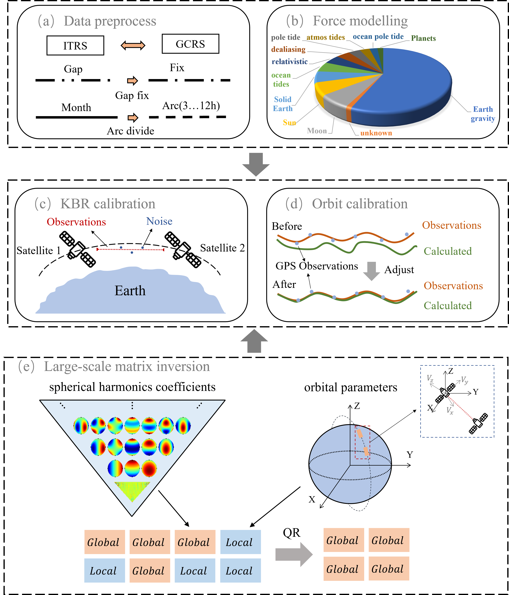

# PyHawk: An efficient solver for precise orbit calibration, inter-satellite ranging calibration and global gravity field recovery from GRACE and GRACE-FO

#### Description
Time-Variable Gravity field (TVG) represent the cumulative gravitational signals from all geophysical sources at any given moment. The global TVG signals observed from space contain information about mass redistribution occurring within the Earth's system, making them a new data type for monitoring climate and geophysical changes. For instance, the derived Total Water Storage (TWS) from TVG has been identified as an essential climate variable (ECV) for studying global climate change. In this study, we present a free, open-source, parallel and Python based PyHawk software for processing SST tasks, distinct from GROOPS. This not only offers users an alternative choice but also enhances the diversity of publicly available processing frameworks for cross-validation. More importantly, we chose to develop PyHawk in Python to help users better understand the processing chain and to provide future developers with more maintainable code.

    

#### Contact

Yi Wu (wu_yi@hust.edu.cn) , Fan Yang (fany@plan.aau.dk) , ShuHao Liu (liushuhao@hust.edu.cn)

Huazhong University of Science and Technology
Geodesy Group (see https://aaugeodesy.com/), Department of Sustainability and Planning, Aalborg University, Aalborg 9000, Denmark

This work is supported by the Huazhong University of Science and Technology. Additional supports come from and Aalborg University.

#### Features

1.  Users can modify all parameters related to the data processing workflow in the JSON configuration file, such as the calculation start time, selection and parameter settings for background force models, and calibration strategies for orbits and KBRR;
2.  Users can flexibly select the required modules based on their needs, such as performing only data reprocessing or conveniently generating benchmark comparisons;
3.  We enhance computational efficiency at the code level by encapsulating it in a dynamic library and managing data with HDF5 files;
4.  Building on existing dynamical integration methods, we propose a matrix-based dynamical integration method that can accommodate multiple satellites or even formations simultaneously;
5.  Utilizing modern parallel computing technologies, we optimize the entire codebase, enabling both segment and CPU parallelism, thereby improving computational efficiency from both fronts

#### Software Architecture

1.  Flexibly divide functions, such as modifying JSON files through the interface and only dividing satellite observation data into arc segments, coordinate conversion, orbit calibration, etc;
2.  Compatible with Linux, Windows, and MacOS operating systems, and supports parallel computing and supercomputer distributed computing to improve computing efficiency;
3.  Adopting object-oriented programming language (Python), the system code is highly decoupled internally and has ease of use, readability, and scalability;
4.  The unique advantage of using Python is that high-performance computing libraries (such as numpy, pandas, etc.) not only simplify system code, but also improve computational efficiency to achieve comparable computational efficiency to C++, Fortran, and Matlab.

#### Installation

Please follow below the step-by-step instruction to do the installation, given that the Conda environment has been established already. 
Here we provide the requirements for quick installation. It is recommended that users create an additional virtual environment for installing and running PyHawk. The benefits of doing so include avoiding interference with existing dependencies and creating a clean environment to build the project, where only the necessary packages need to be installed. A simpler installation via .yml to copy the environment will also be released soon. While PyHawk does not specify the version of Python, it is strongly recommended to use python > 3.8.

1. conda create -n py-hawk python=3.8.10
2. source activate py-hawk
3. pip install -r requirments.txt

#### Instructions

1.  使用 Readme\_XXX.md 来支持不同的语言，例如 Readme\_en.md, Readme\_zh.md
2.  Gitee 官方博客 [blog.gitee.com](https://blog.gitee.com)
3.  你可以 [https://gitee.com/explore](https://gitee.com/explore) 这个地址来了解 Gitee 上的优秀开源项目
4.  [GVP](https://gitee.com/gvp) 全称是 Gitee 最有价值开源项目，是综合评定出的优秀开源项目
5.  Gitee 官方提供的使用手册 [https://gitee.com/help](https://gitee.com/help)
6.  Gitee 封面人物是一档用来展示 Gitee 会员风采的栏目 [https://gitee.com/gitee-stars/](https://gitee.com/gitee-stars/)
